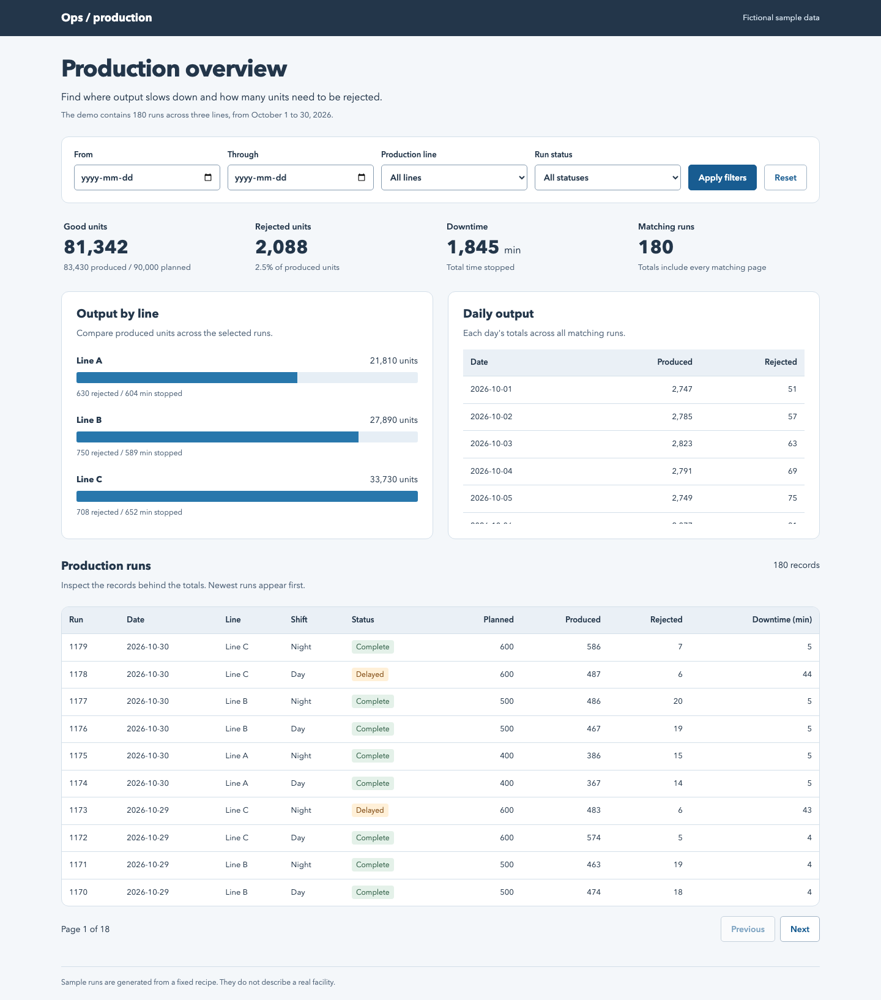

I built a production dashboard because I wanted to compare output, rejected units and stopped time without adding up rows by hand. I can narrow the view to a date range, a production line or delayed runs, then inspect the individual records behind each total.

The included example has 180 fictional production runs across three lines in October 2026. It contains no real facility or personal data.

## Try it

Install [Node.js 24](https://nodejs.org/en/download), then run these commands in a terminal:

```sh
git clone https://github.com/jackaI1/angular-express-ops-dashboard.git
cd angular-express-ops-dashboard
npm ci
npm run seed
npm run build
npm start
```

Open **http://localhost:3000**. Choose dates, a line or a status and click **Apply filters**. **Reset** shows every sample run again. Use **Next** and **Previous** below the records to move through pages. Press Ctrl+C in the terminal when finished.

The totals always cover every matching run, even when the table shows only ten records. “Good units” means produced units minus rejected units. The rejection percentage is rejected units divided by produced units, so a small run does not count as much as a large one. No output is shown as “No output” instead of a misleading percentage.



## How I put it together

The Angular app provides the filters, comparisons and records table. It asks an Express.js API, a set of HTTP addresses that return data, for the totals and records. I wrote the API in TypeScript and store the runs in SQLite, a database kept in one local file. No database service or account is needed.

I validate each query before it reaches the database, including real calendar dates, permitted line names and page limits. SQL queries calculate the totals and bind filter values separately from the query text. The records have a fixed order so two pages do not overlap when runs share a date.

The API has shared error handling and a limit of 300 requests per minute per client address. The dashboard explains invalid filters and server failures, provides a retry, and cancels older requests when a new filter is applied.

## Run and change it

```sh
npm run dev      # API on port 3000, Angular development view on port 4200
npm test         # API integration tests, then Angular tests
npm run build    # Compile both apps
npm run test:smoke  # Seed a temporary database twice and check the compiled app over HTTP
npx playwright install chromium
npm run test:browser  # Exercise the real dashboard at desktop and mobile widths
```

`npm run seed` replaces only rows marked as demo data, using the same fixed recipe each time. It leaves other rows alone. The default database is `data/operations.sqlite`, which Git ignores. Set `DATABASE_PATH` to an absolute file path to use a separate database; set `PORT` to change the API port. Environment variables are read from the shell.

The server listens on this computer only. This is a local, read-only demonstration. I have not added login, importing real facility data or editing runs. The rate limit is kept in one server process; a shared deployment would need shared limit storage and a deliberate proxy configuration.

## API and implementation details

| Address | What it returns |
| --- | --- |
| `GET /api/summary` | Output, rejection and downtime totals |
| `GET /api/lines` | The same totals grouped by production line |
| `GET /api/trends` | Daily totals, oldest date first |
| `GET /api/runs` | Matching records with page counts |
| `GET /api/health` | A database connectivity check |

For example, with the app running:

```sh
curl 'http://localhost:3000/api/summary?line=alpha&from=2026-10-01&to=2026-10-07'
curl 'http://localhost:3000/api/runs?status=delayed&page=1&pageSize=10'
```

I documented the parameters, response examples and design choices in [docs/api.md](api.md) and [docs/design.md](production-design.md). The main code is in `server/src/`, the dashboard in `web/src/app/`, and the clean-start check in `scripts/smoke.mjs`.

## Checks

One GitHub Actions workflow runs the API and Angular tests, builds both apps, checks the compiled app against a newly seeded database, and exercises dashboard controls in Chromium at desktop and mobile sizes. The automated checks include **35 API and database integration cases**, **8 Angular cases**, **1 compiled-app smoke scenario**, and **1 browser journey**. Supertest sends HTTP requests through the real Express app against SQLite, including hand-calculated totals, invalid inputs, pagination, rate limits and database failures.
