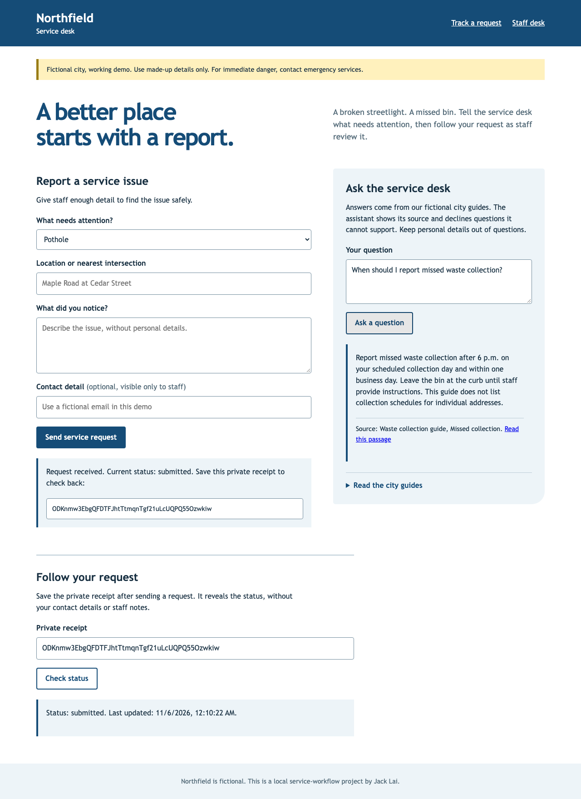

# civic-service-request-assistant

I built a small city service desk to learn how the underlying idea works. This is a learning project.

## Try it

Install [uv](https://docs.astral.sh/uv/getting-started/installation/) to manage Python and [Ollama](https://ollama.com/download) to run the small language model locally. No Microsoft account, cloud API key or paid service is needed.

```sh
uv sync --frozen --python 3.12
cp .env.example .env
```

Replace both token placeholders in `.env` with different random values. A token is the local desk's access password. This prints a new value each time:

```sh
uv run python -c 'import secrets; print(secrets.token_urlsafe(32))'
```

Open three terminals in the project folder:

```sh
# Terminal 1: local question-answering model
OLLAMA_NO_CLOUD=1 ollama serve
# In another terminal, download the model once (about 400 MB):
ollama pull qwen2.5:0.5b
```

```sh
# Terminal 2: a local list service that stands in for SharePoint
set -a; source .env; set +a
uv run uvicorn civic.sandbox:create_sandbox --factory --host 127.0.0.1 --port 8091 --no-access-log
```

```sh
# Terminal 3: the app
set -a; source .env; set +a
uv run uvicorn civic.app:create_app --factory --host 127.0.0.1 --port 8000 --no-access-log
```

1. Open [the resident desk](http://127.0.0.1:8000). Send a fictional report and save its private receipt.
2. Ask “When should I report missed waste collection?” to see an answer and a link to its passage. Try “Who is the mayor?” to see the assistant decline.
3. Open **Staff desk**, enter your `CIVIC_STAFF_TOKEN` and choose a request. Approve it, move it to **in progress**, then **resolved**. Every change needs a short note. Rejection closes a report instead.
4. Expand **Preview safe list export** to see exactly what will be sent. Export it to the local list; exporting again updates that item.
5. Return to the resident desk and paste the receipt under **Follow your request**.

Press Ctrl-C in each server terminal when finished. The two local database files keep your demo records between runs. Delete them only when you want to reset the demo. If the model is unavailable, reporting and staff review still work; the assistant declines answers.



## How I put it together

I kept the service choices, department routing and allowed status changes in [`civic/data/app.json`](civic/data/app.json). Editing that file and restarting changes the form choices and dashboard actions together. It is a small configuration-driven version of a low-code app: the screens reuse the same rules rather than each hard-coding their own flow.

The request queue uses SQLite, a database kept in one file. An approval and its history entry save together. Each record has a version number, so if two people review the same version, the second save asks them to refresh instead of overwriting the first decision.

The question desk first finds one relevant topic in four fictional guide passages. A local Qwen model, run through Ollama, decides whether that passage answers the question. My code checks the returned passage identifier and shows the original passage unchanged. It never displays the model's extra prose. Missing facts, ambiguous topics, invalid replies and connection failures produce an abstention. This deliberately favours a clear source over a conversational answer.

This is my **open-source equivalent of a Power Apps canvas app, a Power Automate approval flow and Copilot Studio FAQ topics**. I used Python and browser forms to reproduce those behaviours. I did not build or deploy a Microsoft Power Platform solution, and this project does not establish hands-on experience in those Microsoft products.

## What stays private

The public desk cannot browse the staff queue. A long, random receipt reveals only one request's status and timestamps. Staff credentials live only in the page's memory and clear when the desk is locked or reloaded.

The list export includes only the request ID, service, department, status, timestamps, version and a generated title. It excludes **all** contact details, locations, descriptions, staff notes and private receipts. The assistant cannot query the request database. Obvious personal details in questions are detected and redacted before any model call; those questions are declined. This detection is best effort, so use fictional details only.

## List integration and limits

The sandbox accepts the same Graph-style REST paths and `fields` envelope used by [LifeOS Open's public Microsoft 365 client](https://github.com/jackaI1/lifeos-open/blob/main/integrations/m365/src/graph-client.ts). REST means sending ordinary web requests to read or change records. The sandbox stores the exported list in its own SQLite database. [`docs/design.md`](docs/design.md) covers the exact schema, API calls and recovery from an uncertain export.

This demo deliberately permits only local model and export endpoints. It has a shared staff token rather than individual accounts, four short guides, a 200-record queue view and no public-hosting abuse controls. It is not a real municipal system or a live SharePoint connection. A real deployment would need individual sign-in, access roles, retention rules, encryption, monitoring and a reviewed Microsoft tenant integration.

## Tests and limits

There are 4 test source files in this copy. No test pass count is claimed here: I have not re-run the project suite as part of this move. This is a source snapshot, and running it on a new machine may need environment-specific setup.


Project checks run from this directory through the path-filtered hub workflows: `civic-service-request-assistant-ci.yml`.
