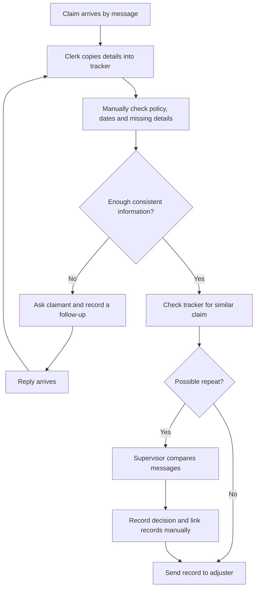
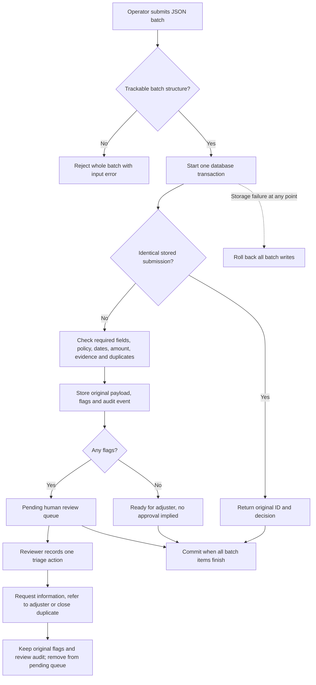

# Functional analysis: fictional home claim intake

Everything here describes a fictional insurer, “Demo Home”. Policies, claims, actors and workload numbers are invented. I used no insurer records or actual customer information. This is intake and triage, not insurance advice, fraud detection or a coverage/payment decision.

## Problem and decision

In this scenario, an intake clerk copies claims from messages into a tracker. Missing details lead to follow-up messages; changed or repeated submissions can look like new work. The business owner needs to decide whether a checklist, a shared spreadsheet or an assisted queue is worth piloting. I recommend the assisted queue subject to the cost assumptions and gates in [decision-summary.md](decision-summary.md).

This is a desk analysis built from explicit assumptions, not research with an insurer. The current process is an assumed baseline. Test results establish that the prototype follows these assumptions; they do not validate the assumptions against a real business.

## People and boundaries

| Fictional role | Need | Responsibility |
| --- | --- | --- |
| Claimant | Know what is missing | Provide details and evidence references |
| Intake operator | Avoid repeated checking and copying | Submit a batch, request missing details |
| Reviewer | Understand why work stopped | Resolve conflicts; refer to adjuster or identify duplicate |
| Adjuster | Receive an organized record | Make downstream coverage and loss decisions outside this system |
| Supervisor / business owner | Reconcile work and choose an approach | Approve pilot rules and compare workload |

Inputs are structured claim data and a fixed policy snapshot. Outputs are a decision per submission, explicit reason codes, a pending review queue, counts and audit events. The `show` command lets reviewers inspect the original details and history, with related record IDs to open for comparison. Those links match an exact reference or the same non-null policy/date/type tuple; they are navigation hints, not re-evaluated decisions. Evidence is represented by labels, not attachments or proof that a document is genuine. Policy dates alone do not establish coverage. No payments, denial letters, customer contact, authentication, document uploads or production policy integrations are implemented.

## Current process (assumed)

Failure points: inconsistent checklists, lost follow-up ownership, duplicate entry and overwritten changes. The assumed handling time is 12 minutes per submission, including average rework. No real time study was done.

## Future process (implemented boundary)

The batch implementation iterates E through K for each item before committing. A reviewer acts only on committed records. External follow-up after `request_information` is outside the prototype. A corrected JSON submission under the same reference creates a new flagged version for a person to compare; it never silently replaces or automatically clears the old record. Clean earlier records are not retroactively rerouted when a later duplicate appears. The later record is flagged so a person can compare both IDs.

## Data contract

Use the [sample claims](../samples/claims.json) as a copyable template. Top-level input must be a non-empty array of objects. Unknown fields are rejected to catch misspelled input names. A non-blank string `claim_ref` is required to track every item; a missing reference rejects the whole batch. Other missing or wrong business details are stored and flagged instead of being discarded. Strings are case-sensitive; references are matched exactly. Use consistent IDs and ISO dates.

| Claim field | Expected value | Missing/invalid behaviour |
| --- | --- | --- |
| claim_ref | Non-blank string; caller's stable reference | Reject batch |
| policy_id, property_id | Non-blank strings matching policy snapshot | Review |
| loss_date, reported_date | YYYY-MM-DD | Review |
| loss_type | water, fire, theft or wind | Review |
| amount_cents | Integer 1 through 1,000,000,000 inclusive | Review; booleans/fractions rejected as amounts |
| description | Non-blank string | Review |
| evidence | Optional array of non-blank string labels | Missing array means no labels; malformed array means review |

Money is integer cents to avoid rounding errors. Policy snapshots contain `policy_id`, `property_id`, `start_date`, `end_date`; start must precede or equal end. Reloading the same snapshot is harmless; replacing a policy with different values is rejected atomically. A new policy version/re-evaluation feature would be needed for production updates. All dates used for rule evaluation come from explicit `--as-of`; audit timestamps record actual UTC execution time.

## Business rules, version 1

Every reason remains visible; no first-failure short circuit hides other issues.

| Rule | Behaviour and reason code | Requirement |
| --- | --- | --- |
| BR01 | Missing policy, property, loss/report date, loss type, amount or description: `MISSING:<field>`; wrong types: `INVALID:<field>` | R01, R02 |
| BR02 | Policy absent from snapshot: `UNKNOWN_POLICY`; property differs: `PROPERTY_MISMATCH` | R03 |
| BR03 | Loss outside inclusive policy start/end: `LOSS_OUTSIDE_POLICY` | R03 |
| BR04 | Invalid ISO date: `INVALID:<field>`; loss after report: `LOSS_AFTER_REPORT`; either date after evaluation date: `FUTURE_DATE` | R04 |
| BR05 | Unsupported type or out-of-range/noninteger amount: `INVALID:<field>`; valid amount at least CAD 25,000: `HIGH_VALUE` | R05 |
| BR06 | Water/fire/wind need `photos`; theft needs `inventory` and `police_reference`: `EVIDENCE_REQUIRED:<label>` | R06 |
| BR07 | Same reference and same canonical JSON: return original record, decision and evaluation date, with `replayed=true` | R07 |
| BR08 | Changed payload, same reference: `REFERENCE_CONFLICT`; different reference with same known policy, valid loss date and supported type: `POSSIBLE_DUPLICATE` | R08 |
| BR09 | Any flags: `NEEDS_REVIEW`; otherwise `READY_FOR_ADJUSTER`. Neither approves coverage or payment | R09 |
| BR10 | Persist immutable intake payload and actor-stamped event in same transaction; no partial claims on failure | R10, R13 |
| BR11 | One review action, with non-blank reviewer ID, on a flagged record only. `close_duplicate` requires BR08; all actions retain original decision | R11 |
| BR12 | Pending queue contains flagged records without a review action; summary retains counts of all flagged and ready records | R12 |

Canonical JSON sorts object keys; array order and supplied string whitespace remain meaningful. Thus reordered evidence labels create a changed version. Duplicate matching is deliberately conservative: multiple actual losses on the same day may be flagged. The result is a request for human comparison, never an accusation of fraud. Rules and evidence requirements are fictional and deliberately uniform across policies.

## Requirements and acceptance

The [completed catalogue](requirements.json) gives R01 through R15 an owner, priority, source, acceptance criteria and implementation status. P1 means required for a pilot; P2 is decision support. The [reusable template](requirements-template.md) adds elicitation, approval, dependencies and change history for future analysis. No fictional owner is represented as having actually approved this work.

The [QA plan](qa-test-plan.md) describes the test design and release gate; the [executed matrix](../reports/qa.md) links every requirement to the test methods that actually ran. Implemented status is not a business sign-off. A pilot would require the business owner to confirm the rules, review rates, handling times and ownership of follow-ups.

## Storage and operating limits

Python's standard library handles JSON and SQLite, a database stored in one local file. `claims` stores immutable submissions and rule results; `events` stores intake/review history; `reviews` records a triage action; `policies` stores the fixed snapshot. SQL uses bound parameters. A SHA-256 fingerprint identifies exact payload retries; the original payload is also kept. A unique reference/fingerprint constraint and `BEGIN IMMEDIATE` write transaction protect retries and duplicate checks across database connections. SQLite waits briefly for a writer, then returns a controlled error; callers may retry the whole batch safely. Within a batch, earlier records are visible to later duplicate checks.

This is a local, sample-data prototype. Audit history is append-only through this application's commands, not tamper-proof against someone editing the database. It has no access controls, retention policy, encrypted evidence storage, backups, claim-size limits or multi-user service API. Duplicate scans read prior records, so performance at insurer scale is unproven. A production decision would need those controls plus domain/legal review of actual rules. No speed or security certification is claimed.
